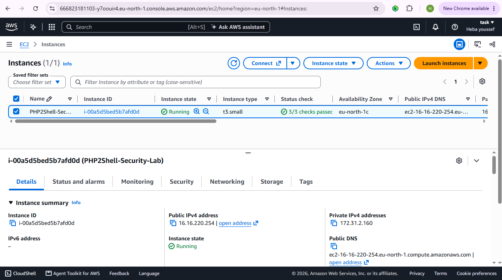
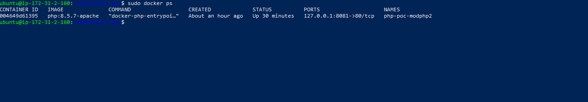
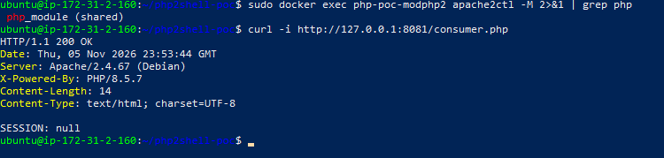
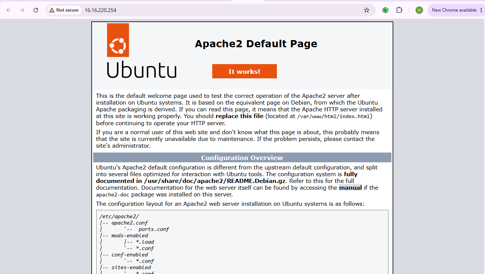
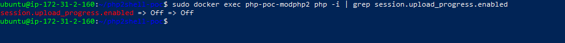

## Why I built this

I wanted hands-on practice with a full vulnerability-research workflow — not just reading about a bug, but standing up an isolated environment, reviewing how a known issue is triggered, and then actually verifying a fix. This post walks through that process for a PHP `session.upload_progress` issue, tracked in my notes as **CVE-2026-109618 / CVE-2026-109619**.

**Scope and ethics note:** everything below ran inside a Docker container I built myself, bound only to `127.0.0.1` on a private EC2 instance — never exposed to the public internet, and never pointed at infrastructure I don't own. If you're following along, keep your own lab just as contained, and never run proof-of-concept tooling against systems you don't have explicit authorization to test.

## 1. Environment

| Component | Configuration |
|---|---|
| Cloud provider | AWS EC2 |
| OS | Ubuntu Server 24.04 LTS |
| Instance type | t3.small |
| Web server | Apache (`mod_php`) |
| PHP version | 8.5.7 |
| Isolation | Docker, container port bound to `127.0.0.1:8081` only |

Keeping the container on localhost-only binding was the single most important safety decision — it meant the vulnerable stack was reachable only from inside the instance itself, never from the internet.


*The lab instance, confirmed running with 3/3 status checks passed.*

## 2. Setting up Apache + PHP

I built the lab on top of the official `php:8.5.7-apache` image, loaded the `pwn` extension used for instrumentation, and confirmed Apache was actually serving through the PHP module (`php_module (shared)`).

```bash
sudo docker ps
```


*The container running, with the port mapping confined to localhost — `127.0.0.1:8081->80/tcp`.*

A basic request confirmed the stack was alive:

```bash
sudo docker exec php-poc-modphp2 apache2ctl -M 2>&1 | grep php
curl -i http://127.0.0.1:8081/consumer.php
```


*Apache confirmed loading the PHP module, and `consumer.php` responding `200 OK`.*

```text
HTTP/1.1 200 OK
SESSION: null
```

As a sanity check, I also confirmed the base Apache install itself was healthy before layering the lab app on top:


*Stock Apache2 default page, confirming the web server tier was working before adding the PHP lab app.*

## 3. The vulnerable configuration

The starting PHP session configuration was intentionally left at its (insecure-by-default-in-some-deployments) state:

```ini
session.upload_progress.enabled=1
session.use_strict_mode=0
session.save_path=/var/www/html/sessions
```

`session.upload_progress` lets PHP write attacker-influenced session data during a file upload before the request finishes processing — a class of issue that's been the basis for several real-world session-poisoning and local-file-inclusion-to-RCE chains over the years when combined with other weaknesses (predictable save paths, permissive include logic, etc.).

## 4. Reviewing the proof-of-concept

Rather than writing exploit code from scratch, I reviewed an existing PoC repository to understand the *shape* of the attack path, covering a few testing modes:

- session poisoning
- handler mismatch
- include-sink abuse
- memory corruption (excluded from this round of testing)

**Important honesty note for the writeup:** I reviewed the PoC logic and understood the attack path conceptually, but I have **not yet reproduced a working remote-code-execution result** in my own lab. That's a separate, harder validation step I'm leaving as future work rather than overstating here. A proof-of-concept you haven't verified yourself isn't a proof of anything yet — worth saying plainly in any writeup.

## 5. Applying the mitigation

The fix here doesn't require a PHP upgrade — just disabling the feature that enables the attack surface. I dropped a mitigation file into the PHP config directory:

**`zzz-mitigation.ini`**
```ini
session.upload_progress.enabled=Off
```

(The `zzz-` prefix is a common trick to force PHP to load this file *last*, so it overrides earlier config.)

```bash
sudo docker restart php-poc-modphp2
```

Verified:

```bash
sudo docker exec php-poc-modphp2 php -i | grep session.upload_progress.enabled
```


*Confirmed: the setting flipped from its vulnerable default to `Off` after the mitigation file was applied and the container restarted.*

The change was scoped to the Docker testing container only — the host Ubuntu PHP install was left untouched.

## 6. Confirming the app still works

Disabling a feature is only useful if the application keeps functioning:

```bash
curl -i http://127.0.0.1:8081/consumer.php
```

```text
HTTP/1.1 200 OK
SESSION: null
```

Same result as before the mitigation — so the fix didn't break anything observable in this minimal app.

## 7. Takeaways / hardening checklist

- Keep PHP patched to a release that addresses the relevant advisory.
- Disable `session.upload_progress` unless your application explicitly needs upload-progress bars.
- Never expose a testing/vulnerable environment to the public internet — bind to localhost or a private subnet.
- Run containers with least privilege.
- Monitor web server logs for unusual upload activity.
- Don't run PoC/exploit code against anything you don't own or aren't authorized to test.

## What's next

This lab currently covers environment setup, PoC review, and mitigation + verification — the parts I can confirm and show working end-to-end (see screenshots above). What it *doesn't* include yet is a live, externally-triggered differential test: running the exploit from a separate attacker-controlled machine against the vulnerable config, then re-running it against the patched config to show the fix actually holds under a real attempt rather than just a config check.

That's a deliberate scope boundary, not an oversight. Reliably triggering a remote-code-execution path on a target you don't fully control the timing of is a non-trivial step on its own, and claiming it without having actually reproduced it would undermine the rest of this writeup. I'd rather ship an honest, three-quarters-complete lab than a fabricated full one.

If I complete the attacker-side test later — most likely via an SSH tunnel from a separate machine into the EC2 instance's private-only container, never exposing it publicly — I'll publish it as a dedicated follow-up with its own screenshots and results.

---

*All testing in this post was performed in an isolated lab environment that I own and control. Nothing here is instruction to test systems you don't have permission to test.*
